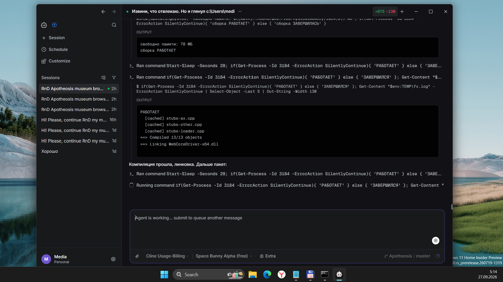
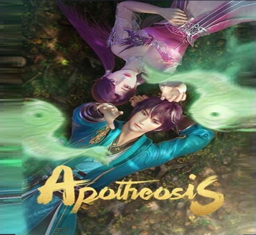

# Project Apotheosis 0.2.0.xx — EdgeHTML Reborn


## Documentation

** Start here** [Doc/INDEX.md](Doc/INDEX.md)  

**Live work and acceptance:** [Doc/PLAN.md](Doc/PLAN.md) · [Doc/MVP.md](Doc/MVP.md)  

Detailed dated investigations are retained locally in `Doc/Archive/`; they are history, not the current spec.

## Abstract

Porting modern **WebKit/WebCore** to **Windows 10 Mobile (ARM32, UWP)** for a deliberately small Lumia 950
browser: address bar, Back, painted pages, scrolling, and useful navigation.



## Historical record — August 2026 and earlier

The older claims below are preserved, not revalidated for .93. In particular, the old
JSC/JIT diagnosis and GPU checkmarks do not establish the cause or rendering status of this run.

---

## Status

### Real device — Lumia 950, Win10M 15254.603 (Aug 21, 2026)

| Feature | Status |
|---------|--------|
| Deploy + launch over Device Portal (WiFi, ~20 min for a 45 MB appx) | ✅ |
| Startup through all 11 constructor checkpoints | ✅ |
| ICU 78 init, `ubrk_open` verified | ✅ |
| HTTPS via curl + OpenSSL with the packaged `cacert.pem` | ✅ |
| First page in a session renders | ✅ `example.com` → `nonwhite=177840/177840`, `rs=C` |
| JavaScript on a real site | ✅ `ya.ru`: React bundles report `l1e0f1` — loaded, no error, executed |
| Touch reaching the engine | ✅ `ManipDelta: session=1 dx=1.2 dy=4.6` |
| **Second and later loads in one session** | ❌ **blank frame** (`nonwhite=0`) with `rs=C`, `pending=0` and correct layout — or, before the reload fix, a silent process death with no UEF line and no dump |
| Scrolling on `about:home` | ⚪ disabled by design — no engine session for the internal page |

> The earlier device milestones — JIT, GPU compositing, live sessions, pinch-zoom, the browser shell —
> were verified on previous builds and are listed further down; this table is the current run.

### x64-uwp line (Aug 2026)

| Component | Status |
|-----------|--------|
| WebKit CMake configure (x64-uwp, GPU + JIT + FTL_JIT) | ✅ |
| WTF + bmalloc + PAL + JavaScriptCore + WebCore | ✅ |
| Port driver (`WebCoreDriver-gpu.lib`) | ✅ |
| **Harness appx** (manifest `0.1.8.51`) | ✅ **builds, registers, launches on Win11 AppContainer**; loads real pages — `example.com` → `rc=0`, `title=Example Domain` (see log) |
| **XAML activation** | ✅ **fixed via XBF bypass, code-only UI fallback** |
| **Engine DLL load + JSC init + `Page::create` + first style pass** | ✅ |
| **Text rendering on x64** | ✅ `about:home` paints antialiased glyphs (Tier-3 font crash fixed Aug 10, complex-text-path routing fixed Aug 11) |
| **CJK text** | ✅ **hang root-caused & fixed (Aug 16)** — `FontDataCacheKeyTraits::emptyValue` hash-sentinel infinite loop; simhei system fallback via forced bundled face; 8/8 trace suite passes |
| **Real sites** | ✅ `example.com` loads (`rc=0`); ladder `file://` → `http(s)://` → big sites ongoing |
| **GPU compositing (ANGLE D3D11 FL9.3)** | ✅ **renders undistorted** — whole-content stretch FIXED Aug 16 via `WebCoreGpuResize` (surface recreated at ContentArea size on the engine thread; verified `contents=1024x694`, repeated resizes `rc=0`, no crash). Real-device (ARM32) validation pending |
| **ARM32 toolchain** | ✅ **installed and proven** — `Microsoft.VisualStudio.Component.VC.14.44.17.14.ARM` (the *versioned* component; the tree is pinned to toolset 14.44.35207). VS 2022 17.14 ships no `vcvarsamd64_arm.bat`, and `Lib\10.0.26100.0\um\arm` has to be a junction to the 19041 one — both shims are recreated by `Src\tools\arm-bootstrap.ps1`. Details in `Doc/BUILD-ARM32.md` §11 |

> **Toolchain recovery (Aug 14, 2026)**: after the OS reinstall, the whole x64-uwp line was rebuilt
> from scratch (LLVM 22.1.8 / CMake 4.0.1 / Ninja / Python 3.12 / vcpkg 13 ports / ICU75 import libs
> / harfbuzz / Ruby 3.4.10 + MSYS2 / perl / ccache). Engine DLLs are being rebuilt by
> `ninja -C build-x64-gpu WebCore -j1` (scheduled task `ApotheosisNinja`). Details in `Doc/Summary.md`.

### Key breakthroughs (Jul–Aug 2026)

1. **BCryptGenRandom NTSTATUS fix** — logic inversion was crashing JSC init on success. Fixed in `RandomDevice.cpp`.
2. **XAML activation bypass** — skip `Frame::Navigate`/`LoadComponent` (null type-provider in AppContainer); direct page creation.
3. **WebCoreRenderHtml SW pipeline (Jul)** — HTML→layout→Cairo→bitmap→screen verified on x64.
4. **Toolchain recovery (Aug)** — after a Windows reinstall, restored the x64-uwp line (`reinstall-env.ps1`, ICU75 import libs, harfbuzz import lib, fontconfig dropped — 0 refs). Full build green.
5. **Appx v0.1.8.25 launches** — engine init clears XAML/JSC/`Page::create`; crash is localized to font resolution.
6. **CJK hang root-caused & fixed (Aug 16)** — the "strange font height / CJK tofu" report was an infinite loop in `FontDataCacheKeyTraits::emptyValue()`: the WK_WINUWP `FontPlatformData` ctor gave the size-0 hash-table empty-sentinel a live `m_scaledFont`, so a memset-0 slot never compared equal to it and the linear probe spun forever. Fixed by keeping `m_scaledFont` null for size 0 (`if (size)` guard, `FontPlatformData.cpp:182`). CJK now resolves through a forced simhei bundled face (`stubs-font-uwp.cpp` + `apotheosisSetForcedBundledFontName`). Full 8-test trace suite passes (single/mixed/wan-meta/kana-n/br-kana/mixed-e/br-euro/cjk-b — all ALIVE, `gdc-> c=U+4E00 g=1078 ok=1`).
7. **GPU whole-content distortion (FIXED Aug 16)** — `WebCoreGpuInit` created the ANGLE swapchain once at 720×1080 and GPU mode never resized it; the `SwapChainPanel` stretched it to ContentArea, so any aspect mismatch made all content look too wide. Fixed with `WebCoreGpuResize` (`WebCoreDriver.cpp`): the harness posts a resize job (fresh `PropertySet` + `EGLRenderSurfaceSizeProperty`) that recreates the GLContext/surface + TextureMapper on the engine thread, then `finishInteractionPaint`. Verified on x64: `contents=1024x694` post-resize, rc=0 across many live resize cycles, 200×200 test squares stay square. Fonts themselves were always correct.
8. **ARM32 launch crash root-caused (Aug 19)** — `SecurityOrigin::protocol()` and `::host()` returned `const String&` to temporaries. x64 tolerated the dangling reference for months; ARM32 faulted on the first `Document::initSecurityContext`. Both now return `String` by value, which also removed a local patch in `ContentSecurityPolicy.cpp` that had been treating the symptom. Two documented false trails came with it, including a probe that crashed inside its own diagnostics. See `Doc/ARM32-DANGLING-SECURITYORIGIN.md`.
9. **The browser was reloading every page by itself (Aug 20)** — after `WebCoreGpuInit` succeeded, the harness re-navigated to the current URL to "re-render through the compositor". The engine was still loading, so the reload was parked and `NavRetry` replayed it once the first load finished — and the second load of the same page killed the process with no exception and no dump. The first load had already logged `compositing=1`, so the reload could not even have helped. Removed; a composited frame is now requested explicitly instead of refetching the page.
10. **White screen fixed by separating two facts (Aug 20)** — "GPU initialised" and "this document can be presented through the GPU" are not the same. The old code hid the software surface the moment `WebCoreGpuInit` returned 0; on a page with no compositing layers the GPU path then had nothing to draw. Measured: `example.com` reported `EnableCompositing=0 Composite=-12` (`kErrNoSession`) while the engine had painted `nonwhite=177840/177840`. The switch to `GpuPanel` is now conditional on a frame actually coming out of it.
11. **HarfBuzz/ICU divergence between the lines (Aug 20)** — x64 had `USE_HARFBUZZ` **off** and ICU **75.1**; ARM32 has it **on** with ICU **78.3**. Six causal links, from an inverted architecture gate in `OptionsWinUWP.cmake` down to the x64 ICU having no pkg-config files. It surfaced as a duplicate-symbol link error and means every rendering comparison made on x64 was using a different text-shaping engine than the device. See `Doc/HARFBUZZ-ICU-DIVERGENCE.md`.
12. **Open, and now sharply bounded** — the first load in a session renders, later ones do not: the same `example.com` gives `nonwhite=177840/177840` first and `0/177840` third, with `rs=C`, `pending=0` and correct layout each time. One root cause with two faces — it used to crash, now it paints nothing. The load path is healthy; the paint target is not.

---

## Architecture

```
Harness (UWP C++/CX App)
   · SwapChainPanel ← GPU | WriteableBitmap ← SW fallback
        │  C ABI (WebCoreDriver.h)
WebCoreDriver (port layer)
   · Page/frame management, event dispatch
   · Cairo software | TextureMapper GPU rendering
        │
WebKit / WebCore / JSC / WTF
   · WK_WINUWP patches for ARM32 UWP App Container
```

## Repository layout

```
Apotheosis.sln       ← open this in Visual Studio: it holds the harness, and only the harness
Src/
├── port/            ← the WebCore driver, the Port-layer clients, the stubs, the build scripts
│                      NOT built by msbuild — clang-cl + lld-link via link-driver-gpu-{x64,arm32}.ps1
├── harness/         ← the UWP host app (C++/CX, XAML). THIS is the browser
├── tools/           ← deploy over Device Portal, log collection, the x64 test cycle
├── angle/include/   ← ANGLE headers (the binaries are gitignored, they can be re-downloaded)
├── Apotheosis/      ← ⚠ abandoned C# UI experiment. Read Src/Apotheosis/README.md before touching it
├── setenv.ps1       ← run `. .\Src\setenv.ps1` first, every session
Doc/                 ← architecture, plans, and the post-mortems that explain why things are like this
```

**Two platforms, both UWP: x64 and ARM32.** The x64 line is the fast diagnostic mirror; ARM32 on the
Lumia 950 is the real target. There is no Linux or GTK target — the source tarball is called
`webkitgtk-2.52.4` because that is the release the whole WebKit tree was cut for, and this fork compiles
zero GTK or GLib files (measured: 0, against 23 curl and 14 `wtf/win`). `Doc/WIKI_EN.md` §11 explains
the layering, the App Container's compile-time API removal, and where the landmines are.

`Src/Apotheosis/` deserves the warning. It is a deliberately minimal C# port of the UI — address bar and
content view only — stopped in July 2026 and kept because the idea was sound and the stated reason for
dropping it (marshalling cost) does not survive the arithmetic. It is **not** part of any solution and
building it will not produce a browser. Its README has the numbers and what would have to be answered
first.

## Quick Build (x64-gpu, after code change)

```powershell
. .\Src\setenv.ps1
msbuild Src/harness/Harness.vcxproj /p:Configuration=Release /p:Platform=x64 /p:AppxPackage=true /t:Build /v:minimal
```

If engine DLLs need rebuild (WebKit source change):

```powershell
. .\Src\setenv.ps1
ninja -C build-x64-gpu WebCore -j1
# Then rebuild harness (above)
```

### Deploy & run

```powershell
# Install AppX
PowerShell -ExecutionPolicy Bypass -File "Src\harness\AppPackages\Harness\Harness_0.1.8.51_x64_Test\Add-AppDevPackage.ps1"
# Launch
cmd /c start shell:AppsFolder\EdgeHTMLReborn.Harness_edmb40rfkwsbg!App
# Check log
Get-Content "$env:LOCALAPPDATA\Packages\EdgeHTMLReborn.Harness_edmb40rfkwsbg\LocalState\log.txt"
```

> **NOTE:** 4 GB RAM — reboot before large builds. Use `ninja -j1` only. Port file `WebCoreDriver.cpp` may hit `fatal error C1060` if memory is low.

---

## Присоединяйтесь! / 加入我们!

**Apotheosis — это возрождение экосистемы Windows 10 Mobile.** Если у вас есть опыт в C++/CX, WebKit, DirectX, ARM32 кросс-компиляции или просто энтузиазм — вы нам нужны!

- **Нам нужны**: C++ разработчики, тестировщики (особенно с живыми Lumia 950/950 XL), UI/UX дизайнеры, специалисты по WebKit
- **Что делать**: чинить баги, тестировать сборки, документировать, портировать
- **Как помочь**: форкните репозиторий, шлите PR, открывайте issues, пишите на Reddit (r/windowsphone)

**Apotheosis正在让Windows 10 Mobile重获新生。** 如果你有C++/CX、WebKit、DirectX、ARM32交叉编译的经验，或者只是充满热情——我们需要你！

- **我们需要**: C++开发者、测试人员（特别是手上有Lumia 950/950 XL的）、UI/UX设计师、WebKit专家
- **如何贡献**: fork仓库、提交PR、开issues、在Reddit (r/windowsphone)上讨论

---

## Русский

**Project Apotheosis** — портирование современного WebKit (webkitgtk-2.52.4) на Windows 10 Mobile (ARM32, UWP). Движок позволяет Lumia 950 открывать современные веб-страницы с JIT и GPU.

**Июль–Август 2026 — x64-uwp: полная сборка appx 0.1.8.51 установлена и запускается на Win11!**
- ✅ JSC + WebCore DLL грузятся в AppContainer без краша
- ✅ XAML-активация: обход XBF-загрузки (code-only UI)
- ✅ Движковый поток: CreateThread + очередь задач + CoreDispatcher
- ✅ WebCoreRenderHtml (июль): HTML → layout → Cairo paint → bitmap → экран
- ✅ Восстановление тулчейна после переустановки ОС (ICU75, harfbuzz, без fontconfig)
- ✅ Текст рендерится на x64: about:home рисует настоящие глифы (краш Cairo font face — починен 10.08; обход complex-text-path — 11.08)
- ✅ CJK: зависание шрифта устранено (16.08, hash-пустой сентинел), 8/8 тестов
- ✅ **GPU-растяжение всего контента устранено (16.08)**: `WebCoreGpuResize` пересоздаёт surface под размер ContentArea (`contents=1024x694`, квадраты 200×200 остаются квадратами)
- 🔄 Следующий шаг: синхронизация ARM32↔x64 (имена каталогов/скриптов, общая версия appx) + пересборка ARM32 движка для Lumia 950

## 中文

**Project Apotheosis** — 将现代 WebKit 引擎移植到 Windows 10 Mobile (ARM32, UWP)，让 Lumia 950 渲染现代网页。

**2026年7-8月——里程碑：x64-uwp 全量 appx 0.1.8.51 在 Win11 上安装并启动！**
- ✅ JSC + WebCore DLL 在 AppContainer 中加载无崩溃
- ✅ XAML 激活：绕过 XBF 加载（纯代码 UI）
- ✅ 引擎线程：CreateThread + 任务队列 + CoreDispatcher
- ✅ WebCoreRenderHtml（7月）：HTML → 布局 → Cairo 渲染 → 位图 → 屏幕
- ✅ 断桥恢复：Windows 重装后重建 x64-uwp 工具链（ICU75、harfbuzz、去除 fontconfig）
- ✅ x64 文本渲染：about:home 绘制真实字形（Cairo 字体崩溃 8.10 修复；复杂文本路径 8.11 修复）
- ✅ CJK：字体卡死已修复（8.16，hash 空哨兵），8/8 测试通过
- ✅ **GPU 整页拉伸已修复（8.16）**：`WebCoreGpuResize` 按 ContentArea 重建 surface（`contents=1024x694`，200×200 方块保持正方形）
- 🔄 下一步：ARM32↔x64 同步（目录/脚本命名、共享 appx 版本）+ 重建 ARM32 引擎验证 Lumia 950

---

## Roadmap

> **Policy (Aug 2026)**: all GitHub-related tasks (CI, GitHub Actions, auto-releases, PR pipelines,
> GitHub-hosted runners) are **OPTIONAL / non-blocking**. All ARM32 dev/build tasks are **fully local**
> on the dev machine (no cloud runners). Order: local x64 verification → local ARM32 build artifacts →
> manual real-device validation → then (optional) any CI/GitHub automation.

- **ARM32↔x64 sync** (DONE Aug 16): ARM32 dirs renamed `build-clang-*` → `build-arm32-*` (matches `build-x64-gpu` = `build-<arch>-<variant>`); obj suffixes unified (GPU `.arm32.obj` / JIT `.arm32-jit.obj` / soft `.arm32-soft.obj`, x64 `.x64.obj`); `recompile-stubs-arm32.ps1` → `recompile-stubs-x64.ps1`. Both arches build from the SAME `Package.appxmanifest` → **identical appx version** for x64 and ARM32.
- **Local x64** (current): GPU distortion FIXED (`WebCoreGpuResize`). Keep climbing the site ladder (Bing/GitHub/Apple), Enter/SPA/docs interaction; trim harness diagnostics.
- **Local ARM32**: full rebuild (reconfigure `build-arm32-gpu` + multi-hour `ninja -j1` — the old ARM32 tree was wiped by the OS reinstall) → driver link → ARM32 appx (same version). Lumia screen-width differences are a non-issue: the surface always matches ContentArea, so any aspect renders undistorted.
- **Real device (manual)**: deploy the ARM32 appx to the Lumia 950 via `Deploy-Robust.ps1` + WDP; validate the same site ladder + GPU.
- **(Optional) GitHub CI** — `windows-latest` (7 GB RAM) builds x64 faster than the 4 GB dev box (`ninja -j8` ≈ 40 min per engine build); automated releases; fork→PR→auto-build. Only after the local lines are green.

---

## Credits

- [Jimmyxiao2009/Project-Apotheosis](https://github.com/Jimmyxiao2009/Project-Apotheosis) — original project
- [Reddit: Porting WebKitGTK 2.52.4 to Windows 10 Mobile](https://www.reddit.com/r/windowsphone/comments/1ugn2kn/porting_webkitgtk_2524_to_windows_10_mobile/)
- WebKitGTK team — upstream engine

## License

MIT (port layer); LGPL-2.1/BSD (upstream WebKit + dependencies).

## ..

*As is. No support. RnD only. DIY.*

## .
[M][E] 2026


